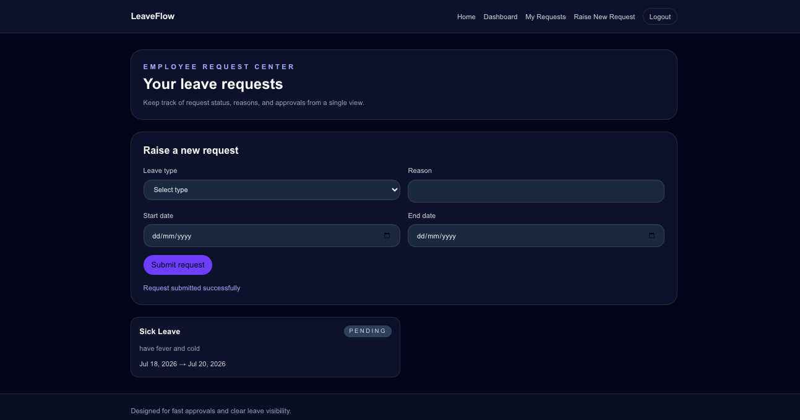

# LeaveFlow

> A calm, modern leave management system for employees, managers, and admins — submit requests, approve with one click, and track everything in real time.



[](https://github.com/your-username/leaveflow/actions/workflows/ci.yml)
[](LICENSE)

**Live demo → https://leaveflow.vercel.app**

## Features

- **Self-service requests** — Employees submit leave with type, dates, and reason
- **One-click approvals** — Managers approve or reject with a single action
- **Admin console** — Define leave types, set policies, monitor all activity
- **Real-time status** — Track every request from submission to decision
- **Dashboard summaries** — Pending, approved, and total counts at a glance
- **Role-based access** — Employee, manager, and admin roles enforced server-side
- **JWT authentication** — Secure login with httpOnly cookies
- **Responsive design** — Works from 320px to wide desktop

## Tech Stack

Next.js 16 · TypeScript · Tailwind CSS v4 · MongoDB · Mongoose · JWT · bcryptjs

## Quick Start

```bash
git clone https://github.com/your-username/leaveflow.git
cd leaveflow
cp .env.example .env.local    # then fill in values
npm install
npm run seed                   # populate demo data (optional)
npm run dev                    # http://localhost:3000
```

## Environment Variables

| Variable | Description | Required |
| --- | --- | --- |
| `MONGODB_URI` | MongoDB connection string | Yes |
| `JWT_SECRET` | Secret key for JWT signing (min 32 chars) | Yes |
| `NEXT_PUBLIC_APP_NAME` | App name shown in UI | No (defaults to LeaveFlow) |

## Demo Credentials

After running `npm run seed`, use these accounts:

| Role | Email | Password |
| --- | --- | --- |
| Admin | admin@example.com | password123 |
| Employee | employee@example.com | password123 |

## Architecture

LeaveFlow uses a role-based data model with three core entities: users, leave types, and leave requests. Auth is handled via JWT tokens stored in httpOnly cookies. The API layer lives in Next.js App Router route handlers under `src/app/api/`.

For full architecture details, see [docs/architecture.md](docs/architecture.md).

### Data Model

```
User ─────┬── LeaveRequest ──── LeaveType
          │
          └── LeaveBalance
```

- **User** — name, email, hashed password, role (employee/admin)
- **LeaveType** — name, code, max days per year
- **LeaveRequest** — employee, type, dates, reason, status, reviewer
- **LeaveBalance** — user + leave type + remaining days

## Project Structure

```
leaveflow/
├── src/
│   ├── app/            # Next.js App Router pages + API routes
│   ├── components/     # Reusable UI components
│   ├── lib/            # Auth, DB connection, utilities
│   └── models/         # Mongoose schemas
├── docs/               # Architecture and schema docs
├── public/             # Static assets
├── .env.example        # Environment variable template
└── README.md
```

## Testing

```bash
npm run test            # unit tests (Vitest)
npm run test:e2e        # end-to-end tests (Playwright)
```

## Roadmap

- [x] Authentication (login/register)
- [x] Leave request CRUD
- [x] Admin approval workflow
- [x] Dashboard with summary stats
- [x] Redesigned landing page
- [ ] Email notifications
- [ ] Calendar view
- [ ] CSV/PDF export

## Screenshots

| Landing | Dashboard | Admin |
| --- | --- | --- |
|  |  |  |

## License

MIT — see [LICENSE](LICENSE).

---

Built for the [Digital Heroes Full Stack Developer Trial](https://digital-heroes.dev).
